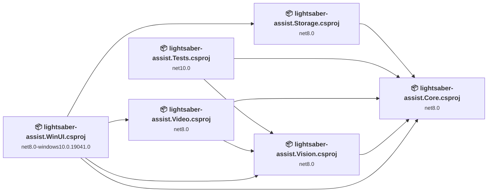
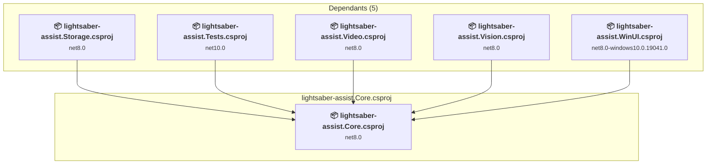
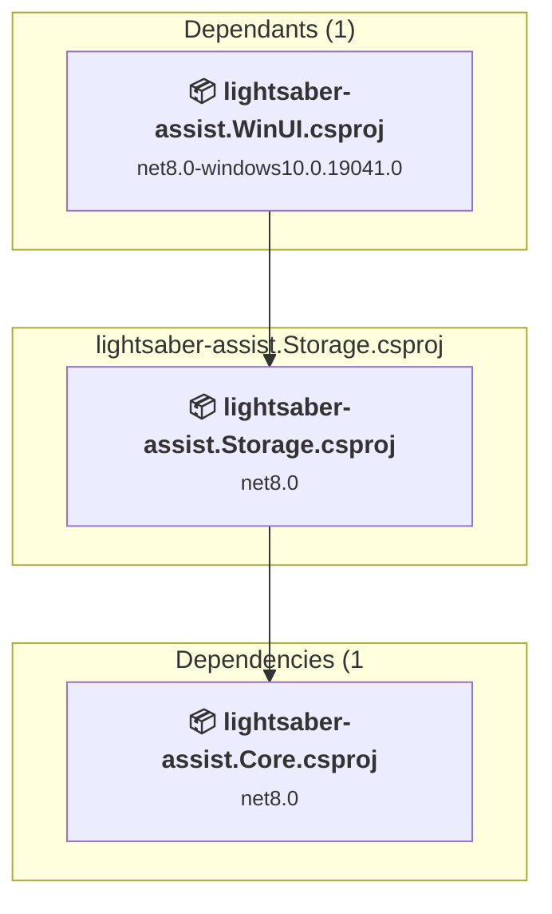
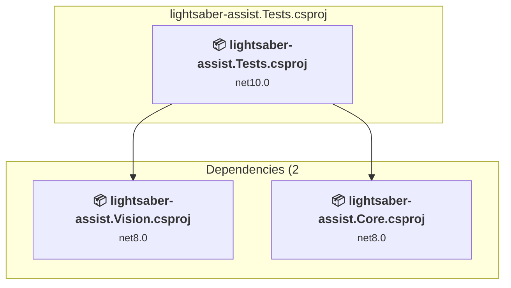
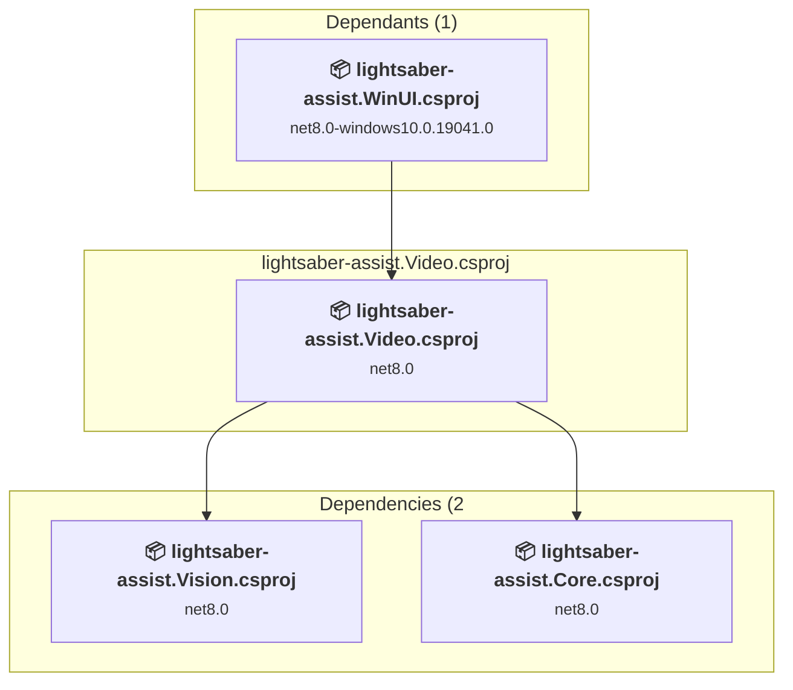
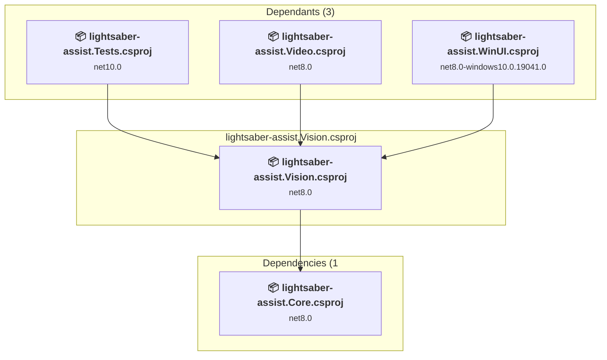
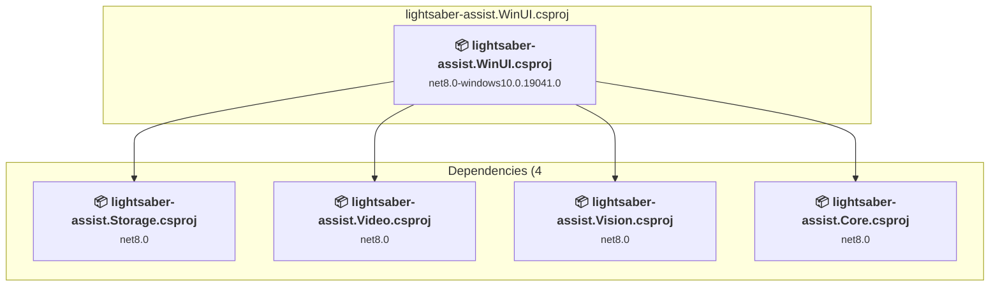

# Projects and dependencies analysis

This document provides a comprehensive overview of the projects and their dependencies in the context of upgrading to .NETCoreApp,Version=v10.0.

## Table of Contents

- [Executive Summary](#executive-Summary)
  - [Highlevel Metrics](#highlevel-metrics)
  - [Projects Compatibility](#projects-compatibility)
  - [Package Compatibility](#package-compatibility)
  - [API Compatibility](#api-compatibility)
  - [Binding Redirect Configuration](#binding-redirect-configuration)
- [Aggregate NuGet packages details](#aggregate-nuget-packages-details)
- [Top API Migration Challenges](#top-api-migration-challenges)
  - [Technologies and Features](#technologies-and-features)
  - [Most Frequent API Issues](#most-frequent-api-issues)
- [Projects Relationship Graph](#projects-relationship-graph)
- [Project Details](#project-details)

  - [lightsaber-assist.Core\lightsaber-assist.Core.csproj](#lightsaber-assistcorelightsaber-assistcorecsproj)
  - [lightsaber-assist.Storage\lightsaber-assist.Storage.csproj](#lightsaber-assiststoragelightsaber-assiststoragecsproj)
  - [lightsaber-assist.Tests\lightsaber-assist.Tests.csproj](#lightsaber-assisttestslightsaber-assisttestscsproj)
  - [lightsaber-assist.Video\lightsaber-assist.Video.csproj](#lightsaber-assistvideolightsaber-assistvideocsproj)
  - [lightsaber-assist.Vision\lightsaber-assist.Vision.csproj](#lightsaber-assistvisionlightsaber-assistvisioncsproj)
  - [lightsaber-assist.WinUI\lightsaber-assist.WinUI.csproj](#lightsaber-assistwinuilightsaber-assistwinuicsproj)

## Executive Summary

### Highlevel Metrics

| Metric | Count | Status |
| :--- | :---: | :--- |
| Total Projects | 6 | 5 require upgrade |
| Total NuGet Packages | 9 | All compatible |
| Total Code Files | 30 |  |
| Total Code Files with Incidents | 6 |  |
| Total Lines of Code | 3669 |  |
| Total Number of Issues | 11 |  |
| Estimated LOC to modify | 6+ | at least 0,2% of codebase |

### Projects Compatibility

| Project | Target Framework | Difficulty | Package Issues | API Issues | Binding Issues | Est. LOC Impact | Description |
| :--- | :---: | :---: | :---: | :---: | :---: | :---: | :--- |
| [lightsaber-assist.Core\lightsaber-assist.Core.csproj](#lightsaber-assistcorelightsaber-assistcorecsproj) | net8.0 | 🟢 Low | 0 | 0 | 0 |  | ClassLibrary, Sdk Style = True |
| [lightsaber-assist.Storage\lightsaber-assist.Storage.csproj](#lightsaber-assiststoragelightsaber-assiststoragecsproj) | net8.0 | 🟢 Low | 0 | 0 | 0 |  | ClassLibrary, Sdk Style = True |
| [lightsaber-assist.Tests\lightsaber-assist.Tests.csproj](#lightsaber-assisttestslightsaber-assisttestscsproj) | net10.0 | ✅ None | 0 | 0 | 0 |  | DotNetCoreApp, Sdk Style = True |
| [lightsaber-assist.Video\lightsaber-assist.Video.csproj](#lightsaber-assistvideolightsaber-assistvideocsproj) | net8.0 | 🟢 Low | 0 | 6 | 0 | 6+ | ClassLibrary, Sdk Style = True |
| [lightsaber-assist.Vision\lightsaber-assist.Vision.csproj](#lightsaber-assistvisionlightsaber-assistvisioncsproj) | net8.0 | 🟢 Low | 0 | 0 | 0 |  | ClassLibrary, Sdk Style = True |
| [lightsaber-assist.WinUI\lightsaber-assist.WinUI.csproj](#lightsaber-assistwinuilightsaber-assistwinuicsproj) | net8.0-windows10.0.19041.0 | 🟢 Low | 0 | 0 | 0 |  | WinForms, Sdk Style = True |

### Package Compatibility

| Status | Count | Percentage |
| :--- | :---: | :---: |
| ✅ Compatible | 9 | 100,0% |
| ⚠️ Incompatible | 0 | 0,0% |
| 🔄 Upgrade Recommended | 0 | 0,0% |
| ***Total NuGet Packages*** | ***9*** | ***100%*** |

### API Compatibility

| Category | Count | Impact |
| :--- | :---: | :--- |
| 🔴 Binary Incompatible | 0 | High - Require code changes |
| 🟡 Source Incompatible | 4 | Medium - Needs re-compilation and potential conflicting API error fixing |
| 🔵 Behavioral change | 2 | Low - Behavioral changes that may require testing at runtime |
| ✅ Compatible | 1816 |  |
| ***Total APIs Analyzed*** | ***1822*** |  |

## Aggregate NuGet packages details

| Package | Current Version | Suggested Version | Projects | Description |
| :--- | :---: | :---: | :--- | :--- |
| coverlet.collector | 6.0.4 |  | [lightsaber-assist.Tests.csproj](#lightsaber-assisttestslightsaber-assisttestscsproj) | ✅Compatible |
| Microsoft.ML.OnnxRuntime | 1.31.1 |  | [lightsaber-assist.Vision.csproj](#lightsaber-assistvisionlightsaber-assistvisioncsproj) | ✅Compatible |
| Microsoft.NET.Test.Sdk | 17.14.1 |  | [lightsaber-assist.Tests.csproj](#lightsaber-assisttestslightsaber-assisttestscsproj) | ✅Compatible |
| Microsoft.Windows.SDK.BuildTools | 10.0.28000.2957 |  | [lightsaber-assist.WinUI.csproj](#lightsaber-assistwinuilightsaber-assistwinuicsproj) | ✅Compatible |
| Microsoft.WindowsAppSDK | 2.6.5 |  | [lightsaber-assist.WinUI.csproj](#lightsaber-assistwinuilightsaber-assistwinuicsproj) | ✅Compatible |
| OpenCvSharp4 | 4.13.0.20261107 |  | [lightsaber-assist.Vision.csproj](#lightsaber-assistvisionlightsaber-assistvisioncsproj) | ✅Compatible |
| OpenCvSharp4.runtime.win | 4.13.0.20261107 |  | [lightsaber-assist.Vision.csproj](#lightsaber-assistvisionlightsaber-assistvisioncsproj) | ✅Compatible |
| xunit | 2.9.3 |  | [lightsaber-assist.Tests.csproj](#lightsaber-assisttestslightsaber-assisttestscsproj) | ✅Compatible |
| xunit.runner.visualstudio | 3.1.4 |  | [lightsaber-assist.Tests.csproj](#lightsaber-assisttestslightsaber-assisttestscsproj) | ✅Compatible |

## Top API Migration Challenges

### Technologies and Features

| Technology | Issues | Percentage | Migration Path |
| :--- | :---: | :---: | :--- |

### Most Frequent API Issues

| API | Count | Percentage | Category |
| :--- | :---: | :---: | :--- |
| M:System.TimeSpan.FromSeconds(System.Double) | 4 | 66,7% | Source Incompatible |
| T:System.Text.Json.JsonDocument | 2 | 33,3% | Behavioral Change |

## Projects Relationship Graph

Legend:
📦 SDK-style project
⚙️ Classic project

## Project Details

### lightsaber-assist.Core\lightsaber-assist.Core.csproj

#### Project Info

- **Current Target Framework:** net8.0
- **Proposed Target Framework:** net10.0
- **SDK-style**: True
- **Project Kind:** ClassLibrary
- **Dependencies**: 0
- **Dependants**: 5
- **Number of Files**: 9
- **Number of Files with Incidents**: 1
- **Lines of Code**: 542
- **Estimated LOC to modify**: 0+ (at least 0,0% of the project)

#### Dependency Graph

Legend:
📦 SDK-style project
⚙️ Classic project

### API Compatibility

| Category | Count | Impact |
| :--- | :---: | :--- |
| 🔴 Binary Incompatible | 0 | High - Require code changes |
| 🟡 Source Incompatible | 0 | Medium - Needs re-compilation and potential conflicting API error fixing |
| 🔵 Behavioral change | 0 | Low - Behavioral changes that may require testing at runtime |
| ✅ Compatible | 740 |  |
| ***Total APIs Analyzed*** | ***740*** |  |

### lightsaber-assist.Storage\lightsaber-assist.Storage.csproj

#### Project Info

- **Current Target Framework:** net8.0
- **Proposed Target Framework:** net10.0
- **SDK-style**: True
- **Project Kind:** ClassLibrary
- **Dependencies**: 1
- **Dependants**: 1
- **Number of Files**: 1
- **Number of Files with Incidents**: 1
- **Lines of Code**: 93
- **Estimated LOC to modify**: 0+ (at least 0,0% of the project)

#### Dependency Graph

Legend:
📦 SDK-style project
⚙️ Classic project

### API Compatibility

| Category | Count | Impact |
| :--- | :---: | :--- |
| 🔴 Binary Incompatible | 0 | High - Require code changes |
| 🟡 Source Incompatible | 0 | Medium - Needs re-compilation and potential conflicting API error fixing |
| 🔵 Behavioral change | 0 | Low - Behavioral changes that may require testing at runtime |
| ✅ Compatible | 144 |  |
| ***Total APIs Analyzed*** | ***144*** |  |

### lightsaber-assist.Tests\lightsaber-assist.Tests.csproj

#### Project Info

- **Current Target Framework:** net10.0✅
- **SDK-style**: True
- **Project Kind:** DotNetCoreApp
- **Dependencies**: 2
- **Dependants**: 0
- **Number of Files**: 6
- **Lines of Code**: 232
- **Estimated LOC to modify**: 0+ (at least 0,0% of the project)

#### Dependency Graph

Legend:
📦 SDK-style project
⚙️ Classic project

### API Compatibility

| Category | Count | Impact |
| :--- | :---: | :--- |
| 🔴 Binary Incompatible | 0 | High - Require code changes |
| 🟡 Source Incompatible | 0 | Medium - Needs re-compilation and potential conflicting API error fixing |
| 🔵 Behavioral change | 0 | Low - Behavioral changes that may require testing at runtime |
| ✅ Compatible | 0 |  |
| ***Total APIs Analyzed*** | ***0*** |  |

### lightsaber-assist.Video\lightsaber-assist.Video.csproj

#### Project Info

- **Current Target Framework:** net8.0
- **Proposed Target Framework:** net10.0
- **SDK-style**: True
- **Project Kind:** ClassLibrary
- **Dependencies**: 2
- **Dependants**: 1
- **Number of Files**: 2
- **Number of Files with Incidents**: 2
- **Lines of Code**: 216
- **Estimated LOC to modify**: 6+ (at least 2,8% of the project)

#### Dependency Graph

Legend:
📦 SDK-style project
⚙️ Classic project

### API Compatibility

| Category | Count | Impact |
| :--- | :---: | :--- |
| 🔴 Binary Incompatible | 0 | High - Require code changes |
| 🟡 Source Incompatible | 4 | Medium - Needs re-compilation and potential conflicting API error fixing |
| 🔵 Behavioral change | 2 | Low - Behavioral changes that may require testing at runtime |
| ✅ Compatible | 300 |  |
| ***Total APIs Analyzed*** | ***306*** |  |

### lightsaber-assist.Vision\lightsaber-assist.Vision.csproj

#### Project Info

- **Current Target Framework:** net8.0
- **Proposed Target Framework:** net10.0
- **SDK-style**: True
- **Project Kind:** ClassLibrary
- **Dependencies**: 1
- **Dependants**: 3
- **Number of Files**: 3
- **Number of Files with Incidents**: 1
- **Lines of Code**: 385
- **Estimated LOC to modify**: 0+ (at least 0,0% of the project)

#### Dependency Graph

Legend:
📦 SDK-style project
⚙️ Classic project

### API Compatibility

| Category | Count | Impact |
| :--- | :---: | :--- |
| 🔴 Binary Incompatible | 0 | High - Require code changes |
| 🟡 Source Incompatible | 0 | Medium - Needs re-compilation and potential conflicting API error fixing |
| 🔵 Behavioral change | 0 | Low - Behavioral changes that may require testing at runtime |
| ✅ Compatible | 632 |  |
| ***Total APIs Analyzed*** | ***632*** |  |

### lightsaber-assist.WinUI\lightsaber-assist.WinUI.csproj

#### Project Info

- **Current Target Framework:** net8.0-windows10.0.19041.0
- **Proposed Target Framework:** net10.0-windows10.0.22000.0
- **SDK-style**: True
- **Project Kind:** WinForms
- **Dependencies**: 4
- **Dependants**: 0
- **Number of Files**: 34
- **Number of Files with Incidents**: 1
- **Lines of Code**: 2201
- **Estimated LOC to modify**: 0+ (at least 0,0% of the project)

#### Dependency Graph

Legend:
📦 SDK-style project
⚙️ Classic project

### API Compatibility

| Category | Count | Impact |
| :--- | :---: | :--- |
| 🔴 Binary Incompatible | 0 | High - Require code changes |
| 🟡 Source Incompatible | 0 | Medium - Needs re-compilation and potential conflicting API error fixing |
| 🔵 Behavioral change | 0 | Low - Behavioral changes that may require testing at runtime |
| ✅ Compatible | 0 |  |
| ***Total APIs Analyzed*** | ***0*** |  |

